# Chattr — Flow-Charts (alle Abläufe)

Referenzdiagramme aller Kernabläufe. **Source of truth zusammen mit
`landing/assets/js/flow-sources.js`**, das die Diagramme auf der Landing-Page
rendert (Accordion in `index.html` Sektion `#technik` + ausgeklappt in
`technik.html`) — Änderungen hier bitte dort spiegeln (und umgekehrt,
Konvention in CLAUDE.md). Gerendert mit [Mermaid](https://mermaid.js.org/);
die Landing-Page bundelt `landing/assets/js/mermaid.min.js`.

## 👤 Konto & Profil

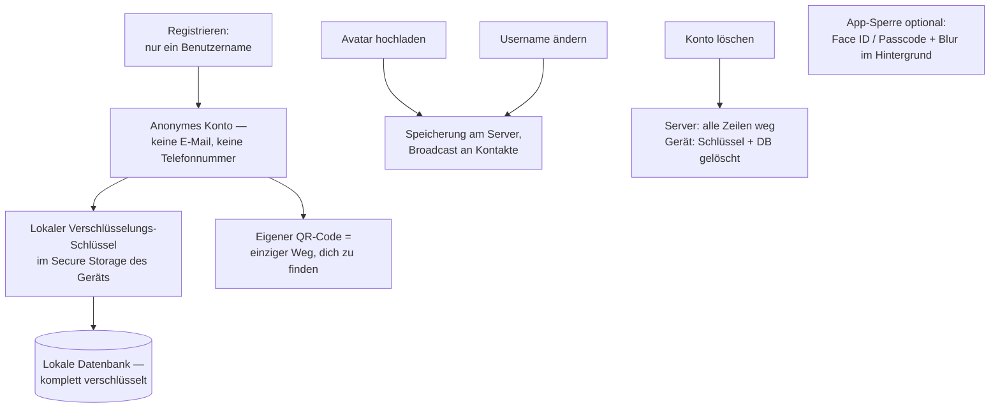

## 🔐 Konto-Wiederherstellung (Phrase & Backup)

Anonyme Konten haben sonst keine Wiederanmeldung — zwei Wege überleben einen Wipe.
**Backup-Datei:** ein passphrase-verschlüsseltes File (Session + Schlüssel), selbst
verwahrt. **Recovery-Phrase:** 24 Wörter, geräteunabhängig, ohne E-Mail — die App bleibt
anonym. Ablauf der Phrase (Challenge-Response, kein Passwort, Owner-Beweis per Signatur):

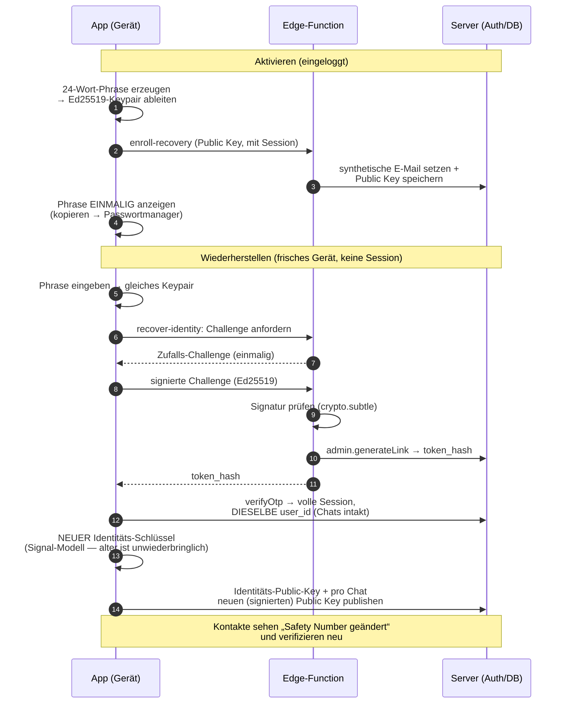

## 🗨️ Chats: 1:1 & Gruppen

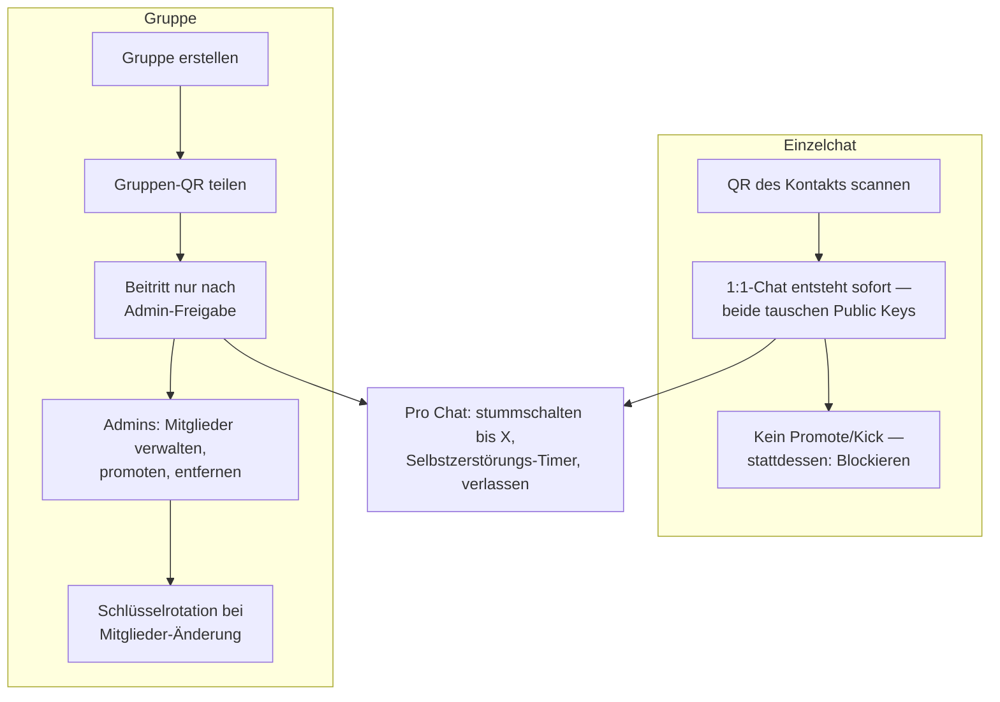

## 💬 Nachricht senden & empfangen

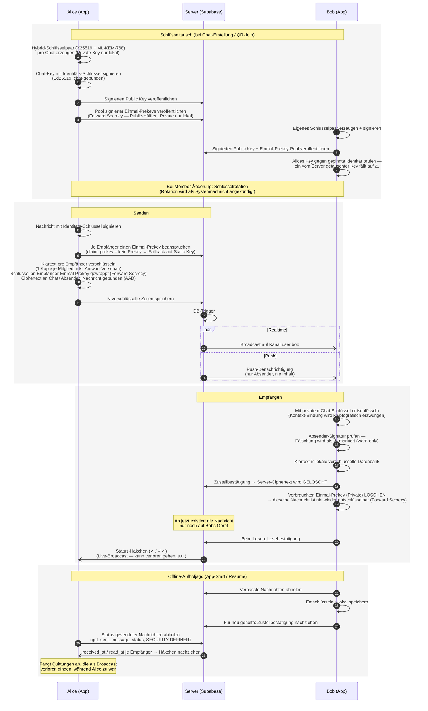

## 📎 Medien: Fotos, Videos, Dateien & Sprachnachrichten

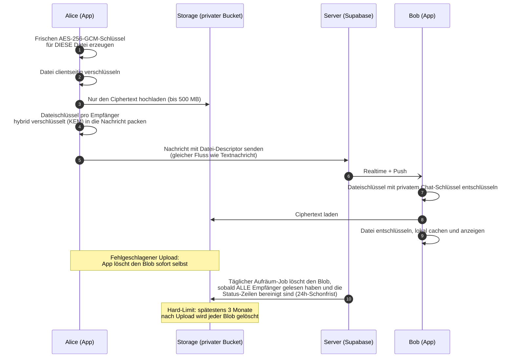

## 👥 Gruppen-Beitritt per QR-Code

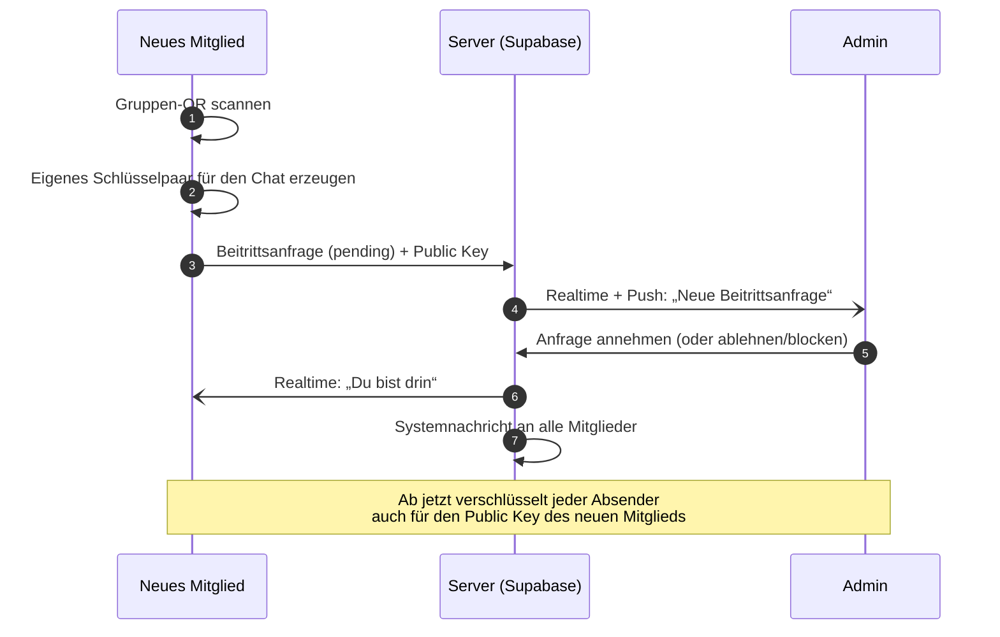

**MCP-Agent-Variante (kein QR nötig):** Ein KI-Agent bindet einen von ihm
erstellten Chat per Token an einen Nutzer (`bind_mcp_chat`-RPC, Migration
`00038`). Dessen App entdeckt den Chat dann selbstständig (RLS-Sichtbarkeit
für `mcp_owner_id`) und durchläuft ab „Eigenes Schlüsselpaar erzeugen“ exakt
denselben Beitritts-Flow wie oben — nur dass „Neues Mitglied“ die eigene App
im Hintergrund ist statt ein QR-Scan. Die Beitrittsanfrage des **Owners** wird
dabei **serverseitig automatisch angenommen** (Trigger `auto_approve_mcp_owner`,
Migration `00039`): Da `mcp_owner_id` aus dem verifizierten Token stammt (nicht
spoofbar), promotet ein `SECURITY DEFINER`-Trigger die Pending-Zeile des Owners
sofort zu einer Mitgliedschaft — der Owner landet nie in der Approval-Queue und
ist unabhängig davon, ob gerade ein Agent läuft. Dabei wird der **Owner zum
alleinigen Admin** des Chats (der Agent wird degradiert, bleibt aber Mitglied
zum Senden) — sowohl beim Beitritt als auch per Backfill für bereits gebundene
Chats (`00044`). So sieht der Mensch die Beitrittsanfragen (Realtime + Push
gehen nur an Admins) und ein prompt-injizierter Agent kann den Chat nicht
verwalten. Beitrittsanfragen anderer Nutzer durchlaufen dadurch den normalen
Admin-Approve **beim Owner**. Details: `docs/MCP_AGENT_SERVER_PLAN.md`.

## ✉️ Gruppen-Einladung als Nachricht (Auto-Approve)

Seit 1.13 kann ein **Admin** eine Gruppe als **Einladungs-Nachricht** in einen
anderen Chat teilen — wer die Karte dort antippt, tritt **ohne weitere
Freigabe** bei. Der Inhalt der Karte (Gruppenname) reist Ende-zu-Ende
verschlüsselt; der Server speichert nur den prüfbaren Zustand des Tokens
(`chat_invites`, Migration `00069`).

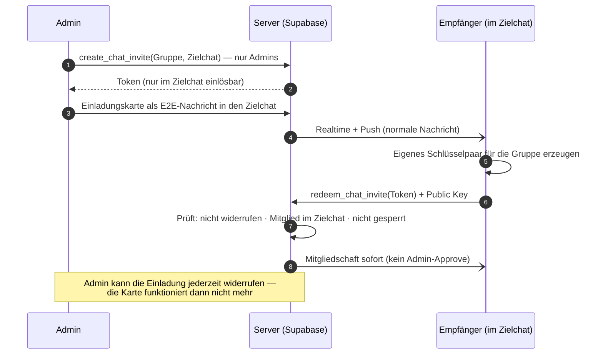

**Warum das sicher bleibt:** Der Token allein öffnet keine Tür. Einlösen kann
nur, wer **Mitglied des Chats ist, in den die Einladung geschickt wurde** —
eine weitergeleitete Einladung ist wertlos. Gruppen-Sperren gelten weiter,
und Erstellen wie Widerrufen können nur Admins (alles serverseitig erzwungen,
`SECURITY DEFINER` + Negativtests).

## 🤖 Chat-Zusammenfassung durch den Agenten (nur MCP-Chats)

Der Zusammenfassen-Knopf existiert **nur in MCP-Chats** — in normalen Chats
hat die Gegenseite nie zugestimmt, dass ein Modell mitliest. Anfrage und
Antwort reisen als **gewöhnliche E2E-verschlüsselte Nachrichten** mit
maschinenlesbarem Rumpf (der Agent ist kein Server, den die App aufrufen
könnte — er wird von einer Nachricht geweckt). Der Server sieht nur
Ciphertext; ein serverseitiges Zusammenfassen schied genau deshalb aus.

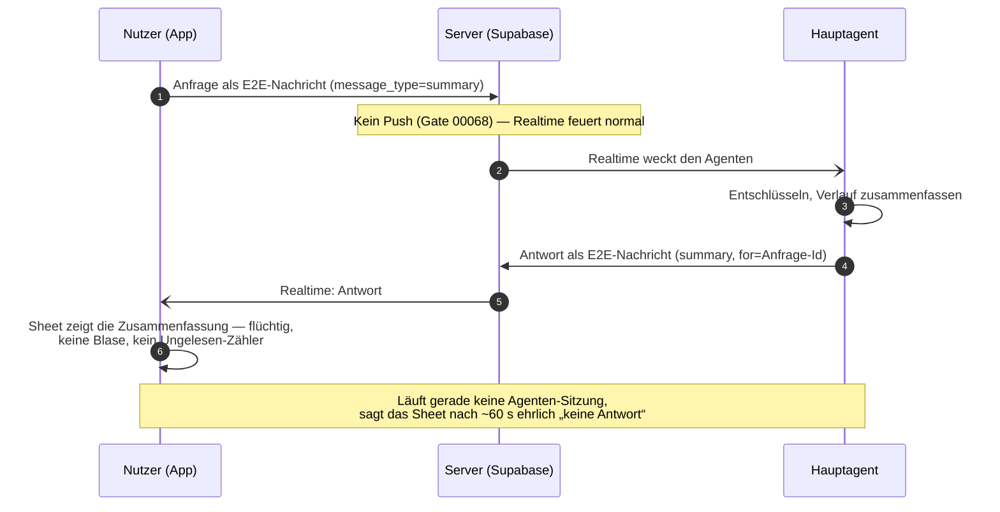

## 🛡️ Identität & Verifizierung (Safety Numbers)

Der Trust-Layer aus dem Security-Audit 2026-07 (C1/H1/M3/H2): ein langlebiger
**Identitäts-Schlüssel** pro Konto beglaubigt alle Chat-Schlüssel und
Nachrichten, damit auch ein **böswilliger Server** keine Schlüssel tauschen
oder Nachrichten fälschen kann, ohne dass die App warnt (warn-only — Senden
bleibt immer möglich).

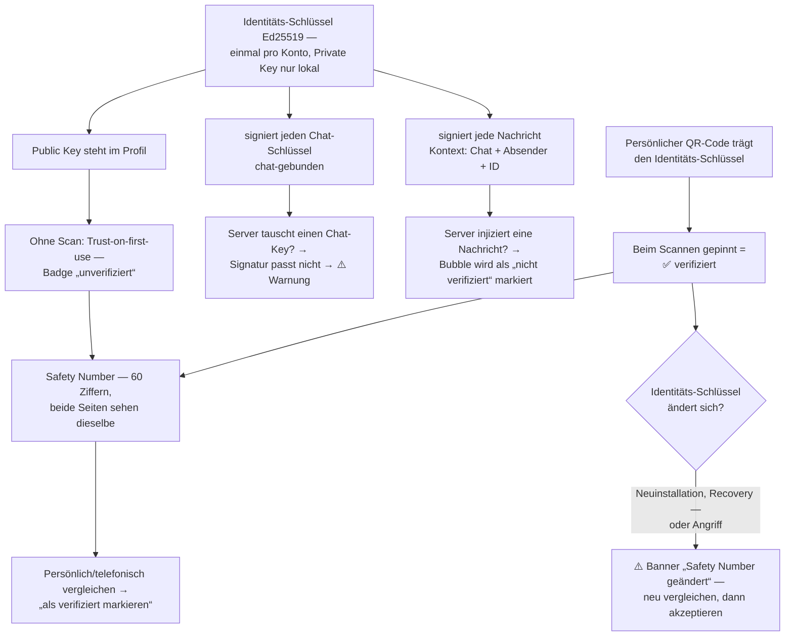

## 🔔 Push-Benachrichtigungen

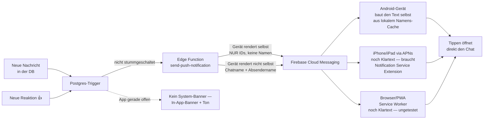

## ⚡ Antworten, Reaktionen, Bearbeiten, Löschen & Selbstzerstörung

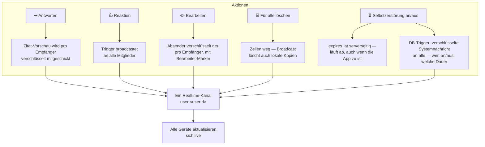

## 🚫 Blockieren (1:1-Chats)

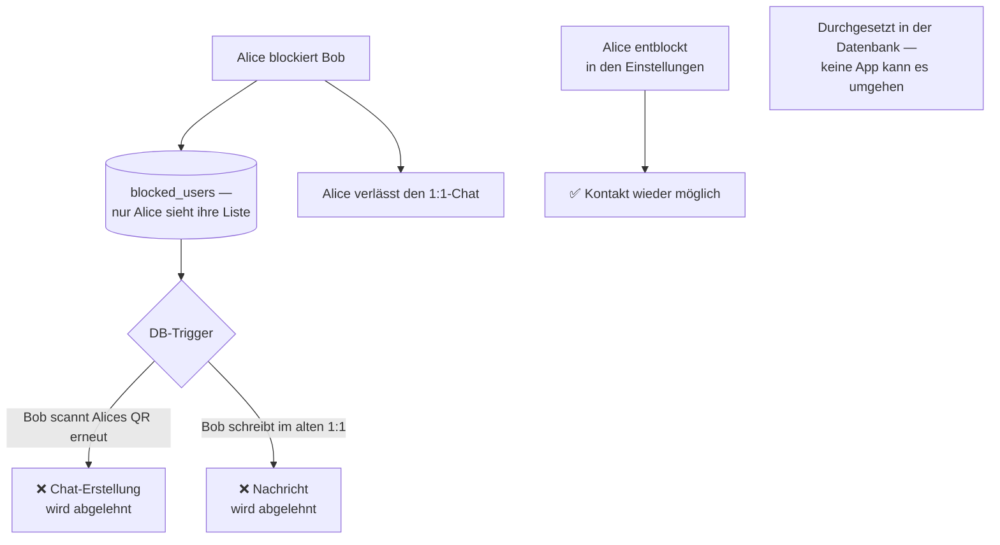

## Kernprinzipien

- **Der Server sieht nie Klartext.** Jede Nachricht wird clientseitig pro
  Empfänger verschlüsselt (eine DB-Zeile je Empfänger); Medien werden vor dem
  Upload AES-GCM-verschlüsselt.
- **Der Server vergisst.** Nach der Zustellung (`markAsReceived`) wird der
  Ciphertext serverseitig gelöscht — die lokale, verschlüsselte Kopie ist
  dann die einzige. Erhalten bleibt nur die inhaltslose **Status-Zeile**
  (Zeitstempel `received_at` / `read_at` je Empfänger); daraus zieht der
  Absender verpasste Häkchen bei App-Start/Resume nach (Backfill).
- **Ein Realtime-Kanal pro User.** Alle Events (Nachrichten, Reactions,
  Edits, Membership) laufen über einen einzigen Broadcast-Kanal
  `user:<userId>` (Event-Bus), nicht über viele Tabellen-Subscriptions.
  Ein verpasster Broadcast (Client war zu) wird bei Start/Resume nachgeholt —
  Nachrichten wie Status-Häkchen.
- **Selbstzerstörung & Blocks** setzen serverseitig an (TTL-Spalte
  `expires_at`, `blocked_users`-Trigger) — Clients können sie nicht umgehen.
- **Auch Medien-Blobs werden gelöscht** (Storage): fehlgeschlagene Uploads
  sofort durch die App; sonst täglicher Reaper, sobald alle Empfänger gelesen
  haben und die Status-Zeilen bereinigt sind (24h-Schonfrist); Hard-Limit
  3 Monate nach Upload (`cleanup-old-media`, Migrationen 00018/00034).
- **Schlüssel sind beglaubigt** (Audit C1): ein Ed25519-Identitäts-Schlüssel
  pro Konto signiert jeden per-Chat-Schlüssel (chat-gebunden). TOFU-Pinning +
  QR-Verifikation + Safety Numbers (Signal-Stil); ein getauschter Schlüssel
  löst eine Warnung aus. Warn-only — nichts blockiert das Senden.
- **Nachrichten sind signiert & kontextgebunden** (Audit H1/M3/H2): Envelope
  v4 trägt eine Identitäts-Signatur über `chat_id‖sender_id‖message_id‖
  plaintext`, die AES-GCM-Schicht bindet denselben Kontext als AAD
  (kein Splice/Relabel/Replay), und der KEM-Key ist hybrid-only mit
  Scheme-Byte (kein stiller X25519-Downgrade).
- **Forward Secrecy** (Audit P3, Envelope v5): jeder Empfänger veröffentlicht
  einen Pool signierter **Einmal-Prekeys**; der Absender wrappt den
  Nachrichtenschlüssel an einen davon, der Empfänger entschlüsselt einmal und
  **löscht** die private Prekey-Hälfte. Danach ist ein mitgeschnittener
  Ciphertext selbst bei späterer Geräte-Kompromittierung nicht mehr zu öffnen.
  Kein Prekey verfügbar → Fallback auf v4 (kein Nachrichtenverlust).
- **Server-Härtung** (Audit M1/H4/H3): `profiles`-SELECT ist auf den eigenen
  Kontext gescoped (keine Nutzer-Enumeration), privilegierte
  SECURITY-DEFINER-Funktionen haben kein öffentliches EXECUTE mehr, und der
  Link-Preview-Proxy validiert Ziele DNS-Resolve-fest gegen SSRF.
